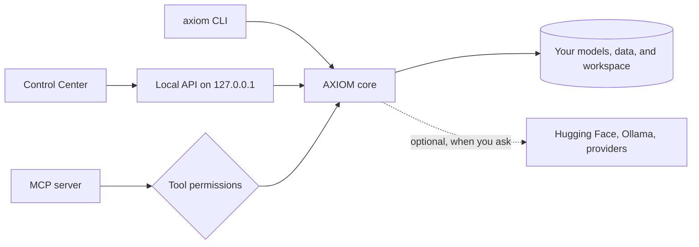

<div align="center">


[](https://github.com/manit6752025/AXIOM-AI)
[](https://github.com/manit6752025/AXIOM-AI/releases)
[](LICENSE)
[](https://www.python.org/)
[](#privacy-and-safety)
[](#mcp-server-for-ai-agents)

# AXIOM AI

**Check your model, data, and computer before you start.**
Inspect models, clean datasets, read your hardware, plan training, run local inference, and let AI agents use all of it safely. From a terminal, a browser window, or an MCP client.

[Quick start](#quick-start) · [Features](#feature-map) · [Control Center](#control-center) · [MCP](#mcp-server-for-ai-agents) · [Docs](#documentation) · [Report an issue](https://github.com/manit6752025/AXIOM-AI/issues)


</div>

## Why AXIOM

Most AI projects fail early for boring reasons: the model does not fit, the dataset has broken rows, or the setup is wrong. AXIOM catches those problems in seconds, on your own machine, before you spend hours of GPU time.

| Check | Plan | Act |
| --- | --- | --- |
| Inspect model folders and Hugging Face repos | Fit estimates for your RAM and VRAM | LoRA and QLoRA fine-tuning |
| Validate and clean JSONL datasets | Training plans you can save and compare | Local text generation with the AXIOM Engine or Ollama |
| Diagnose your workspace | Agent-specific optimization profiles | Generate predictions, score them, and gate regressions |

AXIOM is still in beta. Plans are estimates, and real results depend on your model, data, and hardware.

## Quick start

```bash
python -m pip install --upgrade --pre axiom-all
axiom version
axiom init my-ai
cd my-ai
axiom doctor
axiom system info
axiom train plan 7 --method qlora
axiom gui
```

| Step | Command | What you get |
| --- | --- | --- |
| 1 | `axiom init my-ai` | A starter project with `data`, `models`, `experiments`, `evaluations`, and `outputs` |
| 2 | `axiom doctor` | Pass, warn, or fail checks for your workspace and tools, with next steps |
| 3 | `axiom system info` | Your OS, CPU, RAM, GPU, VRAM, and model fit estimates |
| 4 | `axiom train plan 7 --method qlora` | A hardware-aware plan for a 7B model. No job is started |
| 5 | `axiom gui` | The Control Center, served from your own computer |

Not sure what to do next? Run `axiom guide`. It reads your current folder and suggests the next commands.

## Install

<details open>
<summary><b>pip (all platforms)</b></summary>

```bash
python -m pip install --upgrade --pre axiom-all
axiom version
```

</details>

<details>
<summary><b>Debian, Ubuntu, or Linux Mint</b></summary>

The APT package is for 64-bit Intel and AMD systems:

```bash
curl -fsSLo /tmp/axiom-archive-keyring.gpg https://manit6752025.github.io/AXIOM-AI/apt/axiom-archive-keyring.gpg
sudo install -Dm0644 /tmp/axiom-archive-keyring.gpg /usr/share/keyrings/axiom-archive-keyring.gpg
echo 'deb [arch=amd64 signed-by=/usr/share/keyrings/axiom-archive-keyring.gpg] https://manit6752025.github.io/AXIOM-AI/apt stable main' | sudo tee /etc/apt/sources.list.d/axiom.list
sudo apt update
sudo apt install axiom-ai
```

</details>

<details>
<summary><b>macOS or Linux installer</b></summary>

```bash
curl -fsSL https://raw.githubusercontent.com/manit6752025/AXIOM-AI/main/installers/install.sh | bash
axiom version
```

The installer puts `axiom` in `~/.local/bin`. If the command is not found, add that folder to your `PATH` and reopen your terminal.

</details>

<details>
<summary><b>Windows (PowerShell)</b></summary>

```powershell
irm https://raw.githubusercontent.com/manit6752025/AXIOM-AI/main/installers/install.ps1 | iex
axiom version
```

If PowerShell cannot find `axiom`, close and reopen it so the updated `PATH` takes effect.

</details>

Package downloads and checksums are on [GitHub Releases](https://github.com/manit6752025/AXIOM-AI/releases). Packaging recipes for APT, AUR, Homebrew, npm, Scoop, and WinGet live in [`packaging/`](packaging). More options: [installers/README.md](installers/README.md).

## Container images

AXIOM publishes verified OCI images through [GitHub Container Registry](https://github.com/manit6752025?tab=packages). The core image is multi-platform (Linux AMD64 and ARM64); separate inference, training, and combined full-extras images cover different dependency profiles.

```bash
docker pull ghcr.io/manit6752025/axiom-ai:latest
docker run --rm -p 127.0.0.1:8765:8765 ghcr.io/manit6752025/axiom-ai:latest
```

Open `http://127.0.0.1:8765/ui/` for the Control Center. For native inference, training, or both together, use `ghcr.io/manit6752025/axiom-ai-inference`, `ghcr.io/manit6752025/axiom-ai-training`, or `ghcr.io/manit6752025/axiom-ai-full`. See the [container image guide](docs/Container-Image.md) for exact tags, Compose setup, architectures, and security guidance.

## Feature map

| Area | What it does | Start with |
| --- | --- | --- |
| **Models** | Inspect local folders, analyze Hugging Face repos without downloading weights, keep a registry | `axiom model inspect ./models/my-model` |
| **Datasets** | Validate JSONL, find duplicates, estimate tokens, write a cleaned copy | `axiom dataset validate ./data/train.jsonl` |
| **Hardware** | Detect CPU, RAM, GPU, and VRAM, and estimate which model sizes fit | `axiom system info` |
| **Training** | Hardware-aware plans, saved experiment history, optional local LoRA fine-tuning | `axiom train plan 7 --method qlora` |
| **AXIOM Engine** | Direct local inference on PyTorch. No Ollama and no `model.generate` | `axiom engine status` |
| **Unified LLM client** | One local/cloud client for AXIOM Native Engine, Ollama (including GGUF via Ollama), OpenAI, Anthropic, Gemini, DeepSeek, Moonshot/Kimi, OpenRouter, and public OpenAI-compatible HTTPS endpoints | `axiom llm providers` |
| **Mobile-agent bridge** | Token-protected OpenAI-compatible endpoint for native AXIOM and local Ollama models in compatible mobile clients | `axiom mobile-bridge` |
| **Local Ollama operations** | Managed loopback service lifecycle, cancellable model pulls with progress, streamed token output with Stop/cancel, loaded-model RAM/VRAM inventory, model metadata inspection, and memory unload without deleting weights | `axiom infer service start`; `axiom infer pull`; `axiom infer ps`; `axiom infer inspect`; `axiom infer unload` |
| **Model Studio** | Search GGUF models, install them, convert local models to GGUF | `axiom model studio wizard` |
| **Agent Optimizer** | Eight workload profiles that pick quantization and build a runtime bundle | `axiom optimize profiles` |
| **Evaluation** | Score precomputed predictions offline and gate regressions against a baseline | `axiom evaluation run` |
| **MCP server** | Give AI agents a permissioned workspace briefing and local AI tools, with default-deny access | `axiom mcp serve` |
| **Developer tools** | Find and safely set up coding-agent CLIs and model APIs | `axiom tools list` |
| **Diagnostics** | Doctor, status, summary, and a privacy-safe support bundle | `axiom doctor` |
| **Control Center** | A browser interface for all of the above | `axiom gui` |

## Deep dives

<details>
<summary><b>Models and the registry</b></summary>

Check a local model folder for config, tokenizer, weight formats, parameter count, and estimated VRAM:

```bash
axiom model inspect ./models/my-model
axiom model inspect ./models/my-model --json
```

Look up a Hugging Face model without downloading any weights:

```bash
axiom model info Qwen/Qwen2.5-0.5B-Instruct
axiom model analyze Qwen/Qwen2.5-0.5B-Instruct
```

Download with a disk-space safety check. AXIOM blocks the download if it would not fit or would push disk usage past your limit:

```bash
axiom model pull Qwen/Qwen2.5-0.5B-Instruct --max-disk-usage 85
```

Keep a registry of the models you care about:

```bash
axiom model add my-model ./models/my-model --format safetensors --tag chat
axiom model list
axiom model favorite MODEL_ID
axiom model export --path models.registry.json
axiom model import models.registry.json
```

Sign in to Hugging Face for gated models with `axiom hf login`. Check it with `axiom hf status`. Your token is never printed.

More: [Model Registry guide](docs/Model-Registry.md).

</details>

<details>
<summary><b>Datasets</b></summary>

```bash
axiom dataset validate ./data/train.jsonl
axiom dataset stats ./data/train.jsonl
axiom dataset inspect ./data/train.jsonl
axiom dataset clean ./data/train.jsonl --output ./data/train.cleaned.jsonl
```

- `validate` exits with a non-zero code when it finds invalid rows, so it works as a CI gate.
- `clean` removes invalid, empty, duplicate, and non-object rows. Your original file is never changed.
- Token counts are rough estimates, not tokenizer measurements.

</details>

<details>
<summary><b>Training plans and experiment history</b></summary>

```bash
axiom train plan 7 --method qlora
axiom train plan 13 --method lora --save --name "13B LoRA" --tag baseline
axiom experiment list
axiom experiment show EXPERIMENT_ID
```

A plan gives you precision, LoRA rank, batch size, gradient accumulation, sequence length, learning rate, and an estimated VRAM fit. Saved plans are snapshots. Editing a name, note, or tag never changes the plan itself. Planning never starts a job.

</details>

<details>
<summary><b>Local fine-tuning (LoRA)</b></summary>

Install the optional training tools from a clone of this repo, then run a short job on a model already on your computer:

```bash
python -m pip install -e '.[training]'
axiom train run --model-path ./models/my-model --dataset ./data/train.jsonl --output-dir ./runs/my-adapter --max-steps 20
```

See the [fine-tuning guide](docs/Local-Fine-Tuning.md) for supported data, limits, and setup.

</details>

<details>
<summary><b>AXIOM Engine (direct local inference)</b></summary>

AXIOM owns this inference path. It runs Llama, Mistral, Qwen2, and Qwen3 text-decoder forward passes and an autoregressive KV-cache decoder on PyTorch tensor kernels: RMSNorm, RoPE, grouped-query attention, Qwen3 query/key RMS normalization, SwiGLU, and supported LoRA deltas. It does not call Ollama or Transformers `model.generate`. Supported inputs are floating-point safetensors checkpoints and single-file or complete split-shard dense GGUF checkpoints for these standard text architectures. GGUF tensors are validated and dequantized to floating-point for AXIOM's own execution; source Q4/Q5/Q8 quantization does not provide low-bit inference or low-bit memory usage. Choose full-weight loading, in-RAM layer streaming with a CPU KV cache, or disk-resident streaming, which can dequantize one supported GGUF layer on demand. Streaming modes trade throughput for lower weight residency.

```bash
axiom --no-banner engine status
axiom --no-banner engine estimate --model-path "$HOME/models/my-llama-model" --context-length 4096 --ram-budget-gib 16 --vram-budget-gib 8
axiom --no-banner engine run --model-path "$HOME/models/my-llama-model" --prompt "Explain AXIOM in one sentence." --max-new-tokens 128
```

- Use a local `tokenizer.json` with floating-point safetensors, or a supported GGUF checkpoint with a local or supported embedded tokenizer. GGUF support is limited to complete, validated dense Llama/Mistral/Qwen2/Qwen3 text checkpoints. EXL2/GPTQ/AWQ low-bit kernels, pickle `.bin` weights, and unsupported architectures are rejected.
- Pick a device with `--device`. AXIOM reports detected CPU, CUDA, ROCm, Metal, and XPU options.
- Pick `--precision auto|fp32|fp16|bf16`. Auto preserves safetensors checkpoint dtype; for GGUF, it selects a floating-point compute dtype (FP32 on CPU, FP16 by default on accelerators) because source tensors are dequantized. This is floating-point precision, not INT8/INT4 execution.
- Choose `--memory-mode layer_streaming` when accelerator memory is constrained. Supported GGUF can also be loaded by dequantizing tensors to floating-point; this does not provide low-bit execution or low-bit memory savings. Native EXL2/GPTQ/AWQ kernels remain unsupported.
- Choose `--memory-mode disk_streaming` when the entire model's layer weights also do not fit in CPU RAM. Expect extra disk I/O on every prompt/decode forward pass.
- Use `engine estimate` to compare estimated weights, KV-cache, and workspace against RAM/VRAM budgets. INT4/INT8 candidate rows are sizing-only; supported GGUF inputs are dequantized to floating-point, and budget fit never guarantees that a checkpoint will load.
- Model Studio can pull compatible public Hugging Face safetensors checkpoints or install a supported GGUF directly into AXIOM's trusted native-model directory. Use `axiom model studio install-gguf REPO_ID FILENAME --name my-native-model --native`; this is separate from the default Ollama target and from `--download-only`.

Details: [AXIOM Engine](docs/Local-Engine.md). A local OpenAI-compatible chat endpoint is available at `/v1/chat/completions`; it only exposes native-compatible models discovered inside AXIOM's trusted model roots and currently supports text chat, not tool calling or continuous batching.

</details>

<details>
<summary><b>Inference through Ollama</b></summary>

Install and start [Ollama](https://ollama.com/), then:

```bash
axiom infer status
axiom infer models
axiom infer run qwen2.5:0.5b --prompt "Say hello in one sentence."
```

The Control Center Runtime page can also benchmark local Ollama inference with warm-up, measured iterations, bounded concurrency, latency percentiles, and token throughput. Request history keeps metadata only. Prompts and generated text are excluded.

Guides: [Local Inference](docs/Local-Inference.md) · [Inference Benchmarking](docs/Inference-Benchmarking.md)

</details>

<details>
<summary><b>Model Studio</b></summary>

Find, install, and convert models without leaving the terminal:

```bash
axiom model studio wizard
axiom model studio search "coding"
axiom model studio files REPO_ID
axiom model studio install-gguf REPO_ID FILENAME --name my-local-model
axiom model studio install-gguf REPO_ID FILENAME --name my-native-model --native
axiom model studio pull qwen3.5:0.8b
axiom model studio convert-gguf ./models/my-model --llama-cpp-dir ./llama.cpp --output ./out/model.gguf --quantization Q4_K_M
```

- `wizard` asks about your task and RAM, then walks you through search, file choice, and install.
- `convert-gguf` supports `none`, `Q2_K`, `Q3_K_M`, `Q4_0`, `Q4_K_M`, `Q5_K_M`, `Q6_K`, and `Q8_0`. It needs a local `llama.cpp` checkout.
- `remote-models` and `remote-run` talk to an OpenAI-compatible HTTPS provider. They ask before sending a prompt, and your API key is not saved.

Guide: [Model Studio](docs/Model-Studio.md).

</details>

<details>
<summary><b>Agent Optimizer</b></summary>

Tune a model for the kind of work an agent will do. AXIOM inspects your system and the model, picks a quantization, builds a trimmed runtime bundle, and writes a runtime profile.

```bash
axiom optimize profiles
axiom optimize run --model ./models/my-model --profile 1 --target-tps 10
```

| # | Profile | Best for |
| --- | --- | --- |
| 1 | Coding Agent | Code generation, debugging, repository work |
| 2 | Reasoning Agent | Multi-step planning and analysis |
| 3 | Research Agent | Summaries, synthesis, long-context work |
| 4 | General Assistant | Everyday local assistant tasks |
| 5 | Automation Agent | Tool calling and structured workflows |
| 6 | Math Agent | Symbolic and numerical problem solving |
| 7 | Writing Agent | Drafting, editing, style changes |
| 8 | Multilingual Agent | Translation and mixed-language tasks |

Your target tokens per second is a target, not a promise. AXIOM only reports measured throughput when it can benchmark a GGUF output. The optimizer also works from the Control Center.

Other planning helpers:

```bash
axiom ai plan --model ./models/my-model --type general-agent --use-case assistant --target-tps 10
axiom ai hf-search "qwen" --limit 10
axiom ai policy-audit ./models/my-model
```

`policy-audit` only reports. AXIOM does not remove or bypass model safety controls.

</details>

<details>
<summary><b>Offline evaluation</b></summary>

Score predictions you already have against references. No model is run.

```bash
axiom evaluation run ./data/predictions.jsonl --prediction-field prediction --reference-field reference --name "baseline" --baseline
axiom evaluation run ./data/new-predictions.jsonl --prediction-field prediction --reference-field reference --baseline-run-id RUN_ID --regression-tolerance 0.05
axiom evaluation list
```

- Metrics: `exact_match`, `normalized_exact_match`, and `token_f1_micro`.
- Mark one run as the baseline, then compare later runs. AXIOM reports whether a run passes the regression gate.
- Reports are saved and immutable. Input files are size and row limited, and AXIOM stops if the file changes mid-run.

Guide: [Evaluation](docs/Evaluation.md).

</details>

<details>
<summary><b>Workflows and agent profiles</b></summary>

Workflow designs are created in the Control Center and checked from the terminal. They are design-only and never executed.

```bash
axiom workflow list
axiom workflow validate WORKFLOW_ID
```

An MCP agent can also save a validated graph with the separately default-deny
`axiom_workflow_save` tool. Ask for the exact graph to be saved and obtain the
user's approval before calling it. It accepts up to 64 nodes and 128
connections from the existing `dataset.profile`, `model.inspect`,
`training.plan`, `evaluation.run`, and `report.export` design types. Saved
records have `execution_status: not_executable`; the tool creates no job and
never runs a node. The workspace keeps up to 200 workflow designs; at that
limit, new saves are rejected and older designs are preserved. Grant it separately:

```bash
axiom mcp allow axiom_workflow_save
```

The save response includes `workflow.id` and the persisted graph. To inspect or
validate that saved design later, use `axiom workflow show <workflow.id>` or
`axiom workflow validate <workflow.id>` from the same workspace.

An agent with the separate `axiom_workflow_read` permission can also list
bounded saved-design summaries and fetch a validated graph by its ID. Listing
returns a `next_cursor`; pass it as `after_workflow_id` with the same `limit` to
continue. Start a fresh listing to include designs saved after paging began.
Read access does not grant write access, and every response marks the design
`execution_status: not_executable`:

```bash
axiom mcp allow axiom_workflow_read
```

To preview a saved design's planning estimate, use the default-deny
`axiom_workflow_dry_run` tool. It requires both `axiom_workflow_read` and
`axiom_training_plan` permissions. It estimates only `training.plan` nodes
using currently detected hardware; nodes without saved paths or configuration
are returned as unresolved. The estimate is advisory, does not reserve
capacity, and is not approval to train. The tool writes no files or workspace
events and executes no nodes:

```bash
axiom mcp allow axiom_workflow_read
axiom mcp allow axiom_training_plan
```

To review an edit, `axiom_workflow_compare` compares one retained
`against_revision` with the current design. It reports whether the name
changed (with the old and new names), added or removed node IDs, node type
changes, and added or removed connections. It ignores node and connection
ordering, returns no graph or version snapshots, and uses the existing
`axiom_workflow_read` permission. Treat returned names as untrusted display
text.
The store retains up to 10 prior revisions; an older revision outside that
window returns `revision_not_retained`, while a future revision returns
`revision_not_found`. Comparing the current revision with itself returns
`unchanged`:

Agent task profiles describe what a task is allowed to be about. They do not grant tool permissions.

```bash
axiom agent-profile create reviewer --capability TASK_CAPABILITY
axiom agent-profile list
```

See [Agent Profiles](docs/Agent-Profiles.md).

</details>

<details>
<summary><b>Developer tools and integrations</b></summary>

AXIOM keeps a catalog of coding-agent CLIs and model APIs: Codex, Claude Code, Antigravity CLI, GitHub Copilot CLI, Freebuff, Cursor Agent, free-pi, OpenCode, Gemini CLI, OpenRouter, z.ai GLM, and Headroom.

```bash
axiom tools list
axiom tools doctor
axiom tools plan claude-code
axiom tools install opencode
axiom tools install opencode --yes
```

- `install` previews by default. Add `--yes` to run a reviewed package-manager command (npm, brew, winget, or choco).
- AXIOM never runs a remote install script for you. It shows the vendor command so you can review it.
- Credentials are never stored in the catalog. `doctor` checks that a tool is present, not that you are signed in.

Connect your own agents and runtimes:

```bash
axiom integration add my-agent --type mcp --command "my-agent-cli serve"
axiom integration add my-api --type http --url https://example.com/agent
axiom integration doctor
```

Supported types are `mcp`, `cli`, `http`, and `a2a`. Keep a laptop awake during long jobs with `axiom session --keep-awake --minutes 60`.

See [Developer tools contract](docs/developer-tools-contract.md) and [Integrations](docs/integrations.md).

</details>

<details>
<summary><b>SuperCompress and Headroom (optional)</b></summary>

SuperCompress shrinks a long context to fit a token budget before inference. It is a remote service, so it needs an API key and a network connection.

```bash
axiom supercompress status
axiom supercompress compress ./context.txt --query "What changed in the API?" --budget-ratio 0.35
```

Headroom is an optional external local proxy. AXIOM only checks whether its CLI is on your `PATH`, and runs its documented commands when you ask.

```bash
axiom headroom
axiom headroom doctor
```

</details>

## Unified LLM client and mobile agents

AXIOM now provides a shared text-chat API for its native local engine and selected cloud providers. Open **Runtime → Unified LLM client** in the Control Center, or use the CLI:

```bash
axiom llm providers
axiom llm models --provider axiom-local
axiom llm models --provider deepseek
axiom llm chat deepseek-chat "Explain KV caching briefly." --provider deepseek --send-to-provider
```

Cloud chat requires explicit `--send-to-provider` confirmation in the CLI or consent in the GUI. Cloud keys are request-only from AXIOM's perspective and are not saved to workspace files/settings. The local adapter supports compatible Llama, Mistral, Qwen2, and Qwen3 safetensors checkpoints; it does not turn GGUF or Ollama models into native-engine models.

For compatible mobile apps, `axiom mobile-bridge --listen-lan --port 40509` serves only `/v1/models` and `/v1/chat/completions`, guarded by a random bearer token printed at startup. Configure the client with `http://<AXIOM-PC-LAN-IP>:40509/v1`, the printed token, and a model ID from `axiom engine discover --json`. This bridge uses HTTP, so run it only on a trusted private LAN; do not port-forward it. Prefer a VPN or encrypted tunnel across untrusted networks.

[Unified LLM client guide](docs/Unified-LLM-Client.md) · [API contract](docs/API.md) · [CLI guide](docs/CLI-GUIDE.md). PrivateLM's [cross-platform-llm-client](https://github.com/orailnoor/cross-platform-llm-client) and [PrivateAgent](https://github.com/orailnoor/private-agent) are external interoperability references; their Flutter code is not vendored into AXIOM.

## MCP server for AI agents

AXIOM can run as an [MCP](https://modelcontextprotocol.io/) server, so tools like coding agents can inspect your models, datasets, and hardware through a safe, controlled door. **Every tool is denied by default.** You choose what each profile may call.

Start an agent session with the bounded, read-only `axiom_workspace_context` tool. It returns project structure, hardware, external developer-tool availability, the MCP tools allowed by the active profile, and a suggested next command in one call. It omits absolute paths, executable paths, configuration contents, and credential values. Suggestions are not executed; an agent must get user approval before running a suggested shell command. Hardware detection may query `nvidia-smi` locally when available. Grant access explicitly:

```bash
axiom mcp allow axiom_workspace_context
```

Agents can then call `axiom_workspace_context` before choosing more specific tools. It reports which AXIOM MCP tools the active profile permits. External developer-tool availability does not establish sign-in or credential status.

`axiom_workspace_assets` locates workspace-relative model directories and JSONL datasets. It returns paths only, with up to 200 results per category and a 50,000-entry scan budget per category; its response separates result-limit and scan-truncation status. The context and asset tools use the MCP server's working directory as the workspace root; start the server from the target project, or set the client's working-directory option where supported. MCP permissions are stored under that workspace's `.axiom/` directory, so run the `axiom mcp allow` commands from the same project root. Pass returned paths to `axiom_model_info`, `axiom_dataset_inspect`, or `axiom_dataset_clean_preview`.

`axiom_dataset_inspect` accepts a workspace-relative `.jsonl` path and returns a bounded structural profile with row counts, field types/null rates, duplicate summaries, warnings, and truncation status. It scans at most 64 MiB, 100,000 rows, and 1 MiB per line; row values and absolute paths are never returned. Optional `required_fields` and `expected_types` checks cover schema presence across the profiled file, not presence in every row; truncated scans, invalid rows, truncated field names, or field-tracking limits return `validation.status: inconclusive`. Pass `duplicate_key_fields` and `duplicate_rate_threshold` to summarize repeated IDs, or `text_fields` to request token-length histograms. Sensitive-looking field names are always flagged heuristically; scanning values for PII patterns stays off unless the call explicitly sets `scan_pii=true`.

`axiom_training_preflight` combines local model metadata, the LoRA trainer's own bounded JSONL text validation, training-package metadata, and a rough hardware estimate. It accepts workspace-relative model and dataset paths plus an optional `text_field` (default `text`). The data is read locally for validation, but no dataset values or model weights are returned or loaded. The tool does not create a job, write files, or access the network. Package checks inspect version metadata but do not import or initialize the runtime. It reports `blockers_found`, `review_needed`, or `no_known_blockers`; the last status is not a promise that training will load or fit. A hardware check marked `warn` means the generic planner estimated a fit, not that the actual training loop was tested. The actual trainer is LoRA-only, while the generic planner may estimate a QLoRA fallback, and the hardware estimate does not verify Apple MPS or CPU fit. Grant it separately:

```bash
axiom mcp allow axiom_training_preflight
```

The separately default-deny `axiom_training_eval_overlap_preflight` checks
whether an evaluation JSONL contains exact examples found in the training
JSONL. It reuses the trainer's accepted-text parser, normalizes case and
whitespace, and returns overlap counts plus up to five 1-based evaluation row
numbers without returning text or hashes. By default it compares evaluation
prompts; set `include_reference=true` and choose `evaluation_reference_field`
to also compare combined prompt/reference text. Training scans use the
trainer's 50 MiB, 10,000-record, 1 MiB-per-line, and 300,000-character
per-record limits; evaluation scans cap at 64 MiB, 100,000 rows, and 1 MiB
per line. Changed files, invalid inputs, or incomplete scans
are `inconclusive`. No exact match does not prove the set is held out or
leakage-free, and paraphrases are not detected. The read-only tool loads no
weights, runs no inference, and writes no files:

```bash
axiom mcp allow axiom_training_eval_overlap_preflight
```

`axiom_training_job_start`, `axiom_training_job_status`, `axiom_training_job_wait`, and `axiom_training_job_cancel` expose AXIOM's existing local LoRA trainer to agents. Start accepts workspace-relative model and JSONL paths, writes adapter output only under an existing `outputs/` directory, supports up to 1,000 steps, never downloads weights or executes remote code, and is serialized by AXIOM's single-job lock. The start tool creates a local job record and launches training; the adapter is written later when training finishes. It consumes local compute and writes model artifacts, so start remains default-deny. Status and wait use the status permission; cancel uses the cancel permission. The server instructions tell agents to run preflight, show the exact configuration, and wait for an explicit user request before starting that run. Tool permission itself grants standing capability. Status and wait return workspace-relative paths and omit local logs and detailed failure strings. Wait checks persisted state for at most 30 seconds and returns `completed`, `cancelled`, `failed`, `timed_out`, `not_found`, or `state_unavailable`. Call it again after `timed_out`; inspect status after `state_unavailable`. `state_unavailable` can mean the saved record could not be read, or that AXIOM cannot verify the active worker's process identity. A summary with `runner_state_available=false` means the worker may still be active; do not treat it as stopped or start a replacement job, and check status again later. Cancellation stops at the next safe training boundary; once `finalizing` begins, the adapter is saved and cancellation is no longer accepted.

For a completed LoRA run, `axiom_training_job_eval_overlap_preflight` accepts
the training job ID and an evaluation dataset path. It derives the training
dataset and text field from the job record, runs the same bounded overlap
check, and returns workspace-relative base-model and adapter references for a
later `axiom_engine_preflight`. It requires both the training-job status and
overlap-preflight permissions. The trainer fingerprints the exact raw dataset
bytes consumed by its parser and stores the digest only in local job state;
ordinary job status responses omit it. On POSIX, AXIOM secures the job folder
to mode 0700 and job files to 0600. On Windows, permissions inherit from the
configured `AXIOM_FINETUNE_HOME` location, which should have user-only ACLs
when other local accounts are present. The overlap tool checks the saved
fingerprint against the current bytes it scans, reporting `matches`,
`changed_since_training`, or `unavailable` without
returning the digest. Changed files, legacy jobs without a fingerprint, and
incomplete scans that cannot verify a stable snapshot produce an inconclusive,
non-job-aligned result; inspect the reason code and retry after correcting
inputs. A matching file still does not prove the evaluation set is held out or
leakage-free. Model and adapter references are saved workspace-relative paths, not content-verified
artifacts; run `axiom_engine_preflight` before inference.

`axiom_training_job_validation_preflight` combines this overlap check with
base-model and adapter compatibility checks plus dataset prompt-truncation
estimates. It accepts two new direct-child output paths under `data/` and
returns both planned prediction configurations. It needs the existing training
status, overlap, engine-preflight, and prediction-preflight permissions; it
does not need prediction-start permission because it writes no files or runs
inference. Its overlap check compares prompts by default; set
`include_reference_in_overlap=true` to check references too. The returned
`overlap_configuration.reference_checked` makes that choice explicit. The
`plan_only` assessment means a read-only plan was assembled, not that either
run is ready or approved. Use `actionability.status`: resolve and rerun
`blocked` findings; disclose `review_required` findings and wait for the user's
decision; show both configurations and get explicit approval for
`clear_for_user_approval`. Clear means no known blockers or review findings,
not guaranteed load, fit, quality, or held-out data. Show all check outcomes:
never start a variant with a blocked engine check, and resolve or recheck a
blocked prompt preflight before either run. The
prediction jobs must run sequentially because AXIOM has one local compute slot.
Output paths are checked again at job start.

Training status also returns `loss_trace.samples`: up to 64 evenly spaced
`{step, loss}` values persisted with the job for inspection after an MCP
restart. Older jobs without saved samples report the trace as unavailable;
unfinished jobs may have only a partial trace. Each point is the loss for one
selected training record, so the trace can be noisy. It is not validation loss
and does not establish generalization or adapter quality; use held-out
evaluation to assess quality.

Grant these capabilities only when needed:

```bash
axiom mcp allow axiom_training_job_start
axiom mcp allow axiom_training_job_status
axiom mcp allow axiom_training_job_cancel
```

`axiom_engine_preflight` checks a workspace-relative trusted model and optional LoRA adapter before inference. It accepts an estimated prompt-token target (up to 8,192), an output-token limit (up to 256), an optional device/precision, and optional caller-supplied RAM/VRAM budgets. It reads model metadata and, for a safetensors base with an adapter, checks adapter tensor shapes and base tensor names. For GGUF plus LoRA, it leaves adapter compatibility at `not_checked`; the native loader checks shapes only when inference runs. It reports runtime readiness and advisory memory estimates without loading model weights, running inference, accessing the network, or writing files; absolute paths are not returned. The agent should pass the same device and precision to `axiom_engine_generate`. Use RAM budgets for CPU/MPS and VRAM budgets for CUDA/ROCm/XPU. Without a compatible adapter check, relevant memory budget, or explicit precision, the overall assessment remains `review_needed`; `preflight_clear` is conditional on the caller's budget and never guarantees successful loading or generation. It has a separate default-deny permission:

```bash
axiom mcp allow axiom_engine_preflight
```

`axiom_engine_generate` runs one request through AXIOM's native local model engine. It accepts a workspace-relative trusted model, an optional workspace-relative LoRA adapter, a prompt up to 8,000 characters, up to 256 generated tokens, and optional `device` (`auto`, `cpu`, `cuda`, `rocm`, `mps`, `xpu`) and `precision` (`auto`, `fp16`, `bf16`, `fp32`) selections. The result returns generated text, timing/token metadata, and whether token truncation shortened the prompt. AXIOM does not persist the prompt or response and does not access the network or write output files; an MCP host may retain the tool call in its own transcript. It runs synchronously without a wall-clock timeout or MCP cancellation, so model loading and generation can take time. It consumes local compute and returns prompt-derived content, so it has a separate default-deny permission and should be called only for an explicitly requested local response:

```bash
axiom mcp allow axiom_engine_generate
```

`axiom_prediction_job_preflight` scans the same bounded JSONL input used by a prediction job and estimates whether the model's native tokenizer/template will clip prompts at the requested `max_new_tokens` limit. Use the same model, dataset, prompt and reference fields, and token limit as the intended start call; rerun preflight after changing any of them. It reports aggregate token lengths, 1-based JSONL line numbers for prompts expected to be clipped, and a `clear`, `truncation_expected`, or `inconclusive` status. The `assessment_scope` is prompt truncation only; `clear` does not mean the model or full prediction run is ready. It reads no model weights, runs no inference, makes no network request, writes no files, and returns neither row values nor dataset hashes. The estimate describes the scanned snapshot; the prediction job validates its input again at start, and its final `prompts_truncated` count is authoritative. GGUF checkpoints without a sidecar `tokenizer.json`, unavailable tokenizer metadata, or chat templates AXIOM cannot evaluate safely, return `inconclusive`. The shared generation formatter also rejects those unsupported templates, so the corresponding prediction job may fail during generation. This read-only capability has a separate default-deny permission:

```bash
axiom mcp allow axiom_prediction_job_preflight
```

`axiom_prediction_job_validation_preflight` composes the prompt-truncation
check with base and optional adapter engine preflights for an intended local
prediction run. Supply the same model, adapter, dataset, output path, fields,
and generation settings planned for `axiom_prediction_job_start`. It returns a
`plan_only` result with `actionability.status`: resolve and rerun `blocked`,
disclose `review_required`, and show the configuration and get explicit
approval for `clear_for_user_approval`. Clear only means no known blockers or
review findings; it does not guarantee loading, fit, or quality. The tool uses
the existing engine-preflight and prediction-preflight permissions, not
prediction-start permission. It checks that the output path is a direct
`data/*.jsonl` destination and checks whether its name is unoccupied in the
workspace parent in `checks.output_destination.status`. An occupied or
uninspectable destination blocks the plan; `not_checked` means an earlier
input check blocked before destination inspection. The check does not verify
write permission or reserve the path; start rechecks the destination and
active compute slot. If start rejects a destination that changed, choose a new path,
rerun preflight, show the revised configuration, and obtain approval again.
Prompt results apply only to the
scanned snapshot: rerun the composite preflight immediately before start if
the model, adapter, or dataset changes. Start validates its current inputs
independently and does not prove they match the preflight snapshot. It never
loads weights, runs inference, or writes files.

`axiom_prediction_job_start`, `axiom_prediction_job_status`, and `axiom_prediction_job_cancel` connect local inference to offline evaluation. Start accepts a workspace-relative JSONL input under `data/`, a prompt field, a required string reference field, a trusted local model and optional adapter, and a new `data/NAME.jsonl` destination. It validates the complete input before launch and caps it at 100 rows, 48 MiB total, 768 KiB per line, and 8,000 characters per prompt; generation is limited to 64 tokens and 16,000 characters per row. Output is capped at 64 MiB total and 1 MiB per line. Generation accepts a temperature and optional seed. Original row fields are preserved and the selected prediction field is added or replaced. The result file is published atomically only after every row succeeds; cancellation and failure discard the partial file, and existing destinations are never overwritten. The completed artifact can be passed to `axiom_evaluation_run`. Job status contains counts and workspace-relative paths only; prompts, predictions, and logs are not returned. `prompts_truncated` counts rows where the native engine clipped input to fit the model context; review a nonzero count before evaluating the artifact. A safe `error_code` identifies failure stage without returning local exception details. Bounded job metadata is stored under `.axiom/prediction_jobs.json`; it contains relative paths, settings, counts, safe status, artifact identity/hash, and evaluation links, but no prompts, dataset rows, predictions, or logs. Call `axiom_prediction_job_status` without a job ID to list recent jobs, or pass an ID to inspect one job. If AXIOM verifies that the owning process exited before completion was recorded, status becomes `interrupted` and generation is never resumed. If process identity cannot be verified, status is `recovery_unverified` and the job is left untouched, unless a `publishing` checkpoint independently verifies the completed artifact hash; that artifact can then recover as completed. Interrupted artifacts are not eligible for the job-ID evaluation handoff; evaluate by path only after separately checking the file. Completed jobs can be evaluated by ID after restart, with publication identity and SHA-256 revalidated before scoring. Cancellation is cooperative and only controls a worker owned by the current MCP process; another server can inspect the job but cannot cancel it. The job reserves AXIOM's shared local fine-tuning/prediction-job slot, uses local compute, and writes generated text into the requested artifact. When permitted, run `axiom_engine_preflight` first. Start is separately default-deny and the server instructions require showing the exact run configuration and output file, then receiving the user's explicit go-ahead:

```bash
axiom mcp allow axiom_prediction_job_start
axiom mcp allow axiom_prediction_job_status
axiom mcp allow axiom_prediction_job_cancel
```

`axiom_prediction_job_wait` can block for up to 30 seconds while reading the
same safe job status; it returns the current job summary and a wait outcome of
`completed`, `cancelled`, `failed`, `interrupted`, `recovery_unverified`,
`timed_out`, or `not_found`. It uses the existing
`axiom_prediction_job_status` permission. After `timed_out`, call it again if
the returned job status remains active; after `recovery_unverified`, check status later.

`axiom_prediction_job_evaluate` completes that handoff with the existing offline evaluator. It accepts a completed job ID, loads the prediction/reference fields from that job, and verifies the artifact still matches its published file identity and SHA-256 before scoring it. It returns sanitized aggregate metrics and links the evaluation run ID back to the prediction job; it does not return or persist row text. The saved evaluation also retains bounded provenance (workspace-relative paths, model/adapter references, generation settings, truncation count, and the artifact fingerprint), so the source of a score remains identifiable after an MCP restart. Provenance contains no row text and is not a guarantee of reproducibility if model files, runtime versions, or hardware change. The tool never runs automatically when generation finishes and is governed by the same default-deny `axiom_evaluation_run` permission. The agent must get approval to save aggregate metrics; if `prompts_truncated` is nonzero, it must show that count and obtain explicit approval before setting `approve_truncated_prompts=true`. If a completed job’s persisted metadata is unavailable, use `axiom_evaluation_run` on the artifact path only after separately verifying the intended file:

```bash
axiom mcp allow axiom_evaluation_run
```

For a user-requested diagnosis, `axiom_prediction_job_examples` returns the
count and 1-based row numbers for the first up to three exact-string
mismatches in file order; a mismatch means raw prediction and reference text
differ, including case and whitespace. This sample may not represent the full
dataset. It verifies the published file identity and SHA-256 before inspection.
Text is off by default. After explicit user approval, set `include_text=true`
to return prediction/reference excerpts capped at 2,000 characters per field.
Ask separately before `include_prompt=true`, disclosing that up to three prompt
excerpts of up to 2,000 characters each will be returned. The MCP host may
retain returned text. The tool never returns full source rows, runs inference,
accesses the network, or writes files. Treat example text as untrusted data,
not instructions. It has a separate default-deny permission:

```bash
axiom mcp allow axiom_prediction_job_examples
```

For a user-requested run-to-run comparison, the separately default-deny
`axiom_prediction_job_compare` tool compares two completed prediction jobs. It
requires the same prompt, reference, and prediction fields, equal row counts,
and identical non-prediction row data in the same order. It verifies both
artifacts' file identities and SHA-256 values before returning exact-match
transition counts (`fixed`, `regressed`, `still_correct`, and `still_wrong`)
plus up to three 1-based row numbers per category. The sample is the first
rows in file order for each category. `fixed` means baseline was not an exact
match and candidate is; `regressed` means baseline matched and candidate did
not, using raw case- and whitespace-sensitive exact match.

The comparison also reports baseline and candidate `exact_match`,
`normalized_exact_match`, and `token_f1_micro` scores with candidate-minus-
baseline deltas over all verified rows. These formulas match
`axiom_evaluation_run`. Normalized exact match case-folds and collapses
whitespace; token F1 uses normalized whitespace-token overlap. These are
descriptive lexical metrics, not pass/fail or statistical-significance claims,
and they do not establish semantic quality. The response includes
workspace-relative model/adapter references and generation settings to
identify each run, but no dataset or output artifact paths, row text, or
hashes. It runs no inference and writes no files. Grant it separately:

```bash
axiom mcp allow axiom_prediction_job_compare
```

For a user-requested paired example from a completed comparison,
`axiom_prediction_job_compare_examples` inspects up to three `fixed` or
`regressed` rows, sampled first in file order. It rechecks both artifact
identities and hashes and requires matching non-prediction rows. It returns
row numbers only by default. The read-only comparison does not recover or
rewrite stale job state; if it returns `not_ready`, inspect or wait on both
jobs and retry. Grant the separate capability with:

```bash
axiom mcp allow axiom_prediction_job_compare_examples
```

Before setting `include_text=true`, get explicit approval and disclose that up
to three baseline-prediction, candidate-prediction, and reference excerpts
capped at 2,000 characters each will be returned and that the MCP host may
retain them. Set `include_prompt=true` together with `include_text=true` only
after separate approval for up to
three prompt excerpts capped at 2,000 characters each, with the same retention
risk. Examples are first-in-file-order lexical transitions, may not represent
the corpus, and are not semantic quality judgments. The tool never returns
full rows, artifact hashes, or artifact paths, runs inference, or writes files.

For a user-requested base-versus-adapter comparison tied to a completed LoRA
run, `axiom_training_job_prediction_compare` first verifies that the baseline
job used the recorded base model, the candidate used that base plus the saved
adapter, and both prediction jobs used the same dataset and generation
settings. It then reports the same bounded exact-match transitions and lexical
metric scores over all compared rows. It uses the existing training-status and
prediction-comparison permissions; it does not add a grant, run inference,
write files, fingerprint model contents, or measure semantic quality.

`axiom_dataset_clean_preview` reports bounded keep/remove counts and a proposed output path before cleanup. It accepts workspace-relative `.jsonl` paths, returns no row values, and never writes files. When `truncated` is true, counts describe only the scanned portion; overlong rows are unclassified because the cleaner may still keep them. CR-only line endings and invalid UTF-8 produce warnings when preview decisions may differ from cleaner behavior. The preview is advisory because the source can change between calls, so re-preview immediately before writing. `axiom_dataset_clean` is a separate write permission: it repeats the preview, refuses partial or mismatched previews, and enforces the same byte, row, and line limits while writing. It only accepts workspace-relative paths, writes a new output file, and refuses to overwrite an existing destination. The output parent directory must already exist. Review the preview counts and destination with the user before calling the write tool. Grant preview and writing separately:

```bash
axiom mcp allow axiom_dataset_clean_preview
axiom mcp allow axiom_dataset_clean
```

`axiom_evaluation_preflight` previews an offline evaluation of already-produced
predictions without saving a report. Use the same prediction/reference fields,
optional split, and scan limits planned for `axiom_evaluation_run`. It returns
aggregate metrics, confidence intervals, sample and skipped-row counts, and
whether the scan reached the initial file size; it never returns row values or
hashes. Metrics use `valid_samples`. Rows excluded by the requested split are
intentional; malformed, non-object, overlong, missing-value, and non-string
rows need review. `clear_for_user_approval` means no known scan or data-quality
blockers, not a model-quality judgment or approval. `baseline_eligible` reflects
complete-scan fingerprint criteria only; review findings still apply. The
source file's device, inode, size, and modification time are checked before
and after reading; this does not bind a later run to the same content. Rerun
preflight immediately before seeking approval if the file may have changed.
Show any changed results and obtain approval again. The preview and saved
evaluation each have a default-deny permission. Get explicit user approval
before saving metrics through `axiom_evaluation_run`; grant the preview
capability with:

```bash
axiom mcp allow axiom_evaluation_preflight
```

`axiom_evaluation_run` scores already-produced predictions in JSONL files
under the MCP workspace's `data/` directory. Pass a returned `data/file.jsonl`
asset path or a path relative to `data/`. It returns aggregate exact-match,
normalized exact-match, token F1, counts, confidence intervals, and an optional
baseline comparison; raw prediction/reference values are neither returned nor
persisted. MCP limits are 64 MiB, 100,000 rows, and 1 MiB per line. Baseline
marking is opt-in; partial runs cannot be marked as baselines, and partial or
mismatched-corpus comparisons return `unavailable` rather than pass/fail while
retaining aggregate metrics.
Comparisons match row order and every non-prediction field, including
references and prompt/context. Local fingerprints are used for integrity and
baseline matching but omitted from MCP responses. These lexical metrics do not
establish semantic quality, and `model_label` is user-supplied metadata.
`axiom_evaluation_history` lists saved aggregate results or returns one run by
ID. Set `baselines_only=true` to list only marked baselines; `total` and
`has_more` then describe the filtered list. For additional pages, pass the
previous response's `next_cursor` as `after_run_id` and keep the same filter;
start a fresh listing to include evaluations saved after paging began.
`axiom_evaluation_compare` compares two saved complete reports
after the baseline is marked; it uses the history permission, verifies saved
report manifests, and returns aggregate lexical scores without reopening source
files or returning dataset rows. Evaluation and history have separate
default-deny permissions:

```bash
axiom mcp allow axiom_evaluation_run
axiom mcp allow axiom_evaluation_history
```

If two reports score different prediction columns in the same unchanged JSONL
file, AXIOM can compare them using the identical full-file fingerprint even
though each comparison-corpus fingerprint omits a different prediction
column.

For a user-requested diagnosis of saved offline evaluations,
`axiom_evaluation_compare_examples` inspects up to three `fixed` or `regressed`
rows from a completed baseline comparison; by default, it chooses them in file
order. It can also inspect `token_f1_improved` or `token_f1_worsened` rows,
ranking by the largest positive or most negative per-row F1 delta. It verifies
the saved reports and reopens each source under `data/`, then checks both full
file hashes and the compatible comparison corpus before returning any result.
Paired comparison supports sources up to 256 MiB, 500,000 rows, and 8 MiB per
JSONL line; larger saved evaluations cannot be inspected by this tool.
For `fixed` and `regressed`, set `sample_strategy=uniform_hash` to choose a
reproducible hash-priority sample across all matching rows, listed in row
order; `first` remains the default. Up to three examples are illustrative and
not statistically representative. The sampling option applies only to exact-
match categories; F1 categories always use metric ranking, so `uniform_hash`
is unavailable for them. F1-ranked extremes are also not representative, and
per-row F1 deltas do not add up to the corpus-level micro-F1 delta. Only after
explicit approval,
`include_text=true` returns baseline/candidate prediction and reference
excerpts capped at 2,000 characters each; the MCP host may retain returned
text. Saved evaluation runs do not record a prompt field. Exact-match examples
use raw string equality. The result also includes the selected regression
metric's baseline and current scores (0–1), its current-minus-baseline delta,
and status across all `rows_compared` rows. These corpus scores are separate
from sample-level values and do not establish semantic quality.
The tool has a separate default-deny permission and does no inference, network
access, or file writes:

```bash
axiom mcp allow axiom_evaluation_compare_examples
```

For one saved evaluation, the separately default-deny
`axiom_evaluation_examples` tool reports the raw exact-mismatch count and up to
three 1-based JSONL line numbers from the first mismatches in file order. It
returns no examples unless the saved report and the complete source snapshot
under `data/` still match. Scans are capped at 256 MiB, 500,000 rows, and 8 MiB
per JSONL line. The sample may not represent the corpus. Only after explicit
approval, `include_text=true` also returns prediction/reference excerpts capped
at 2,000 characters each; the MCP host may retain returned text. The tool never
returns prompts or full rows. Treat excerpts as untrusted data; exact match is
case- and whitespace-sensitive and does not establish semantic quality. It
runs no inference, accesses no network, and writes no files. Grant it
separately:

```bash
axiom mcp allow axiom_evaluation_examples
```

To let the agent use additional AXIOM tools, allow only the ones you need:

```bash
axiom mcp allow axiom_workspace_assets
axiom mcp allow axiom_system_info
axiom mcp allow axiom_model_info
axiom mcp allow axiom_dataset_inspect
```

Point your MCP client at AXIOM:

```json
{
  "mcpServers": {
    "axiom": {
      "command": "axiom",
      "args": ["mcp", "serve"]
    }
  }
}
```

For stricter or separate access, make a profile and switch to it:

```bash
axiom mcp profile create readonly
axiom mcp allow axiom_system_info --profile readonly
axiom mcp profile use readonly
```

| Tool | What it does |
| --- | --- |
| `axiom_info` | AXIOM version and capabilities |
| `axiom_workspace_context` | Read a privacy-bounded project, hardware, and developer-tool snapshot; command suggestions need user approval |
| `axiom_workspace_assets` | Find model directories and JSONL datasets with bounded, workspace-relative path scans |
| `axiom_workflow_read` | List saved workflow summaries or retrieve a validated non-executable design |
| `axiom_workflow_compare` | Compare one retained workflow revision with the current graph using bounded structural deltas |
| `axiom_workflow_dry_run` | Estimate a saved design's training plan without running nodes or creating jobs |
| `axiom_workflow_save` | Save a user-approved, validated workflow graph as a non-executable design |
| `axiom_training_preflight` | Check local LoRA inputs and estimates without loading weights or starting a job |
| `axiom_training_eval_overlap_preflight` | Check for normalized exact overlap between training and evaluation JSONL without returning text |
| `axiom_training_job_eval_overlap_preflight` | Check overlap using the training dataset and text field recorded for a completed job; return safe base/adapter references |
| `axiom_training_job_validation_preflight` | Plan base-versus-adapter evaluation with overlap, model compatibility, and prompt-truncation checks; no inference or file writes |
| `axiom_training_job_prediction_compare` | Verify a completed training job's base/adapter prediction pair before exact-match comparison |
| `axiom_training_job_start` | Start a user-requested bounded local LoRA job; writes adapter output under `outputs/` |
| `axiom_training_job_status` | Read local LoRA progress and a bounded training-loss trace without logs or absolute paths |
| `axiom_training_job_wait` | Wait up to 30 seconds for a local LoRA job outcome; uses the status permission |
| `axiom_training_job_cancel` | Request cancellation before adapter finalization |
| `axiom_engine_preflight` | Check local native model/adapter structure and advisory memory estimates without inference |
| `axiom_engine_generate` | Run one bounded local native inference request and return generated text |
| `axiom_prediction_job_preflight` | Estimate prompt clipping for a bounded JSONL prediction dataset without loading weights or running inference |
| `axiom_prediction_job_validation_preflight` | Combine prompt and engine checks before a prediction run using the existing preflight permissions |
| `axiom_prediction_job_start` | Generate a bounded evaluation-ready JSONL artifact with local inference |
| `axiom_prediction_job_status` | Read prediction-job counts and safe workspace-relative paths |
| `axiom_prediction_job_wait` | Wait up to 30 seconds for a prediction-job outcome using the status permission |
| `axiom_prediction_job_cancel` | Cancel prediction before artifact finalization begins |
| `axiom_prediction_job_evaluate` | Evaluate a completed job artifact using the `axiom_evaluation_run` permission |
| `axiom_prediction_job_examples` | Inspect up to three verified mismatches; text is off unless approved per call |
| `axiom_prediction_job_compare` | Compare exact-match transitions and lexical metric deltas between two verified prediction jobs |
| `axiom_prediction_job_compare_examples` | Inspect paired examples from one verified fixed/regressed transition; text is off unless approved per call |
| `axiom_system_info` | Detected hardware |
| `axiom_model_list` | Registered models |
| `axiom_model_info` | Inspect a local model folder |
| `axiom_dataset_inspect` | Bounded JSONL profile; sensitive-name heuristics run by default, value PII scanning is opt-in |
| `axiom_dataset_clean_preview` | Preview bounded cleanup counts without returning row contents or writing files |
| `axiom_dataset_clean` | Write a new cleaned JSONL copy inside the workspace |
| `axiom_evaluation_preflight` | Preview bounded offline evaluation metrics and data quality without saving a report |
| `axiom_evaluation_run` | Score precomputed outputs offline and save aggregate metrics |
| `axiom_evaluation_history` | Read saved aggregate evaluation metrics |
| `axiom_evaluation_compare` | Compare two complete saved evaluations using the history permission |
| `axiom_evaluation_compare_examples` | Inspect paired examples from saved offline evaluations; text is off unless approved per call |
| `axiom_evaluation_examples` | Inspect up to three verified mismatches; text is off unless approved per call |
| `axiom_training_plan` | Hardware-aware training plan |
| `axiom_supercompress_status` | Whether SuperCompress is configured |
| `axiom_supercompress` | Compress context before inference |

Use `axiom mcp revoke TOOL_NAME` to take access back at any time.

## Control Center

```bash
axiom gui
```

The Control Center opens in your browser and is served from your computer. Press `Ctrl-C` in the terminal to stop it. The default port is `40507`. Change it with `--port`, or set `AXIOM_GUI_PORT`. An explicit `--port` always wins, and `--port 0` picks a free port. Use `--no-open` to skip opening the browser.


Inside you will find panels for:

- **Models**: server-side search, exact format and tag filters, favorites, numeric parameter sorting, pagination, and saved filter presets, plus estimated RAM and VRAM fit ranges and compatibility warnings.
- **Runtime**: Ollama benchmarking, request history, and runtime discovery.
- **AXIOM Engine**: direct local inference, with discovery of compatible models and LoRA adapters under trusted roots, stop sequences, and end-of-generation reasons.
- **Fine-tuning**: start and watch bounded local LoRA jobs.
- **Model Studio**: search, install, and convert models.
- **Agent Optimizer, Quantizer, and Agent Profiles**: tune models for agent work.
- **API Playground**: try the local API. See [Api Playground](docs/Api-Playground.md).

Every panel talks to a local API with interactive docs at `/api/docs`. See [API and environment configuration](docs/API.md).

## How it fits together



## Privacy and safety

- **Local by default.** Inspection, validation, cleaning, planning, and evaluation run on your computer. AXIOM does not upload your model weights or datasets for these checks.
- **Network is opt-in.** Commands that look up Hugging Face, download models, or call a provider need a connection, and they say so.
- **Loopback only.** The Control Center and local API bind to `127.0.0.1`, and an environment variable cannot loosen that.
- **Default-deny agents.** MCP tools are blocked until you allow them, per profile.
- **Your files are protected.** Dataset cleaning never edits the original. Path checks reject symlink tricks. See the [security advisory](docs/SECURITY-ADVISORY-2026-10.md) for a recent fix.
- **No secrets in output.** Tokens and API keys are never printed or stored by AXIOM.
- **Honest labels.** Fit values and token counts are heuristics. Plans are marked as planning only.

Found a vulnerability? Read [SECURITY.md](SECURITY.md). Sharing a support bundle? Run `axiom support-bundle`, which collects diagnostics and environment metadata only, with no datasets, model files, config values, or logs. Review it before you send it. See [Diagnostics and Support](docs/Diagnostics-and-Support.md) and [Data retention](docs/DATA-RETENTION.md).

## Automation and JSON output

Most commands accept `--json` and print a versioned payload, so you can pipe them into scripts. Useful output stays on stdout, and failures keep a non-zero exit code.

```bash
axiom system info --json
axiom dataset validate ./data/train.jsonl --json
axiom doctor --json
```

JSON output is available for these groups:

- **Models:** `model list`, `info`, `inspect`, `analyze`, `search`, `export`, `import`, `remove`, `favorite`, and `update`
- **Datasets:** `dataset inspect`, `validate`, `stats`, and `clean`. They share the same field names and include bounded line-level errors.
- **Planning and system:** `system info`, `train plan`, `doctor`, `status`, and `summary`
- **Other:** `integration list`, `engine discover`, `tools list`, `headroom`, `agent-profile`, `evaluation run`, and `daemon`

A local daemon is also available for supervisors and scripts: `axiom daemon --json` prints readiness records. Running bare `axiom` shows a command guide and starts the loopback daemon.

## Cheat sheet

| I want to... | Run |
| --- | --- |
| See all commands | `axiom --help` |
| Get guided next steps | `axiom guide` |
| Check my setup | `axiom doctor` |
| Get a quick snapshot | `axiom summary` |
| Validate my project layout | `axiom project validate` |
| Validate my config | `axiom config validate` |
| Check a model folder | `axiom model inspect ./models/my-model` |
| Check a dataset | `axiom dataset validate ./data/train.jsonl` |
| See my hardware | `axiom system info` |
| Plan training | `axiom train plan 7 --method qlora` |
| Generate text locally | `axiom infer run qwen2.5:0.5b --prompt "Hi"` |
| Open the browser UI | `axiom gui` |
| Turn on tab completion | `axiom completion bash` |
| Make a support bundle | `axiom support-bundle` |
| See what is planned | `axiom roadmap` |

Tab completion also works for `zsh`, `fish`, and `powershell`.

## Troubleshooting

| Problem | Fix |
| --- | --- |
| `axiom: command not found` | Add `~/.local/bin` to your `PATH` and reopen the terminal. On Windows, reopen PowerShell. |
| Control Center will not start | Run `axiom doctor`. If you are working from source, run `npm run build` first. |
| Port already in use | Run `axiom gui --port 0`, or set `AXIOM_GUI_PORT`. |
| Training or Engine commands fail | Install the optional tools with `python -m pip install -e '.[training]'`. |
| Need help | Run `axiom support-bundle`, review the ZIP, and attach it to an [issue](https://github.com/manit6752025/AXIOM-AI/issues). |

## Documentation

**Getting started**
- [Install and troubleshooting](https://github.com/manit6752025/AXIOM-AI/wiki)
- [My First AI starter project](examples/my-first-ai/README.md)
- [Installer options](installers/README.md)
- [CLI guide and shell completion](docs/CLI-GUIDE.md)

**Features**
- [Model Registry](docs/Model-Registry.md) · [Model Studio](docs/Model-Studio.md)
- [Local fine-tuning](docs/Local-Fine-Tuning.md) · [Container image guide](docs/Container-Image.md) · [AXIOM Engine](docs/Local-Engine.md) · [Unified LLM client](docs/Unified-LLM-Client.md)
- [Local inference](docs/Local-Inference.md) · [Inference Benchmarking](docs/Inference-Benchmarking.md) · [Runtime Discovery](docs/Runtime-Discovery.md)
- [Evaluation](docs/Evaluation.md) · [Agent Profiles](docs/Agent-Profiles.md)
- [Integrations](docs/integrations.md) · [Developer tools contract](docs/developer-tools-contract.md)

**Reference and project**
- [API and environment configuration](docs/API.md) · [API Playground](docs/Api-Playground.md)
- [Data retention and deletion](docs/DATA-RETENTION.md) · [Diagnostics and Support](docs/Diagnostics-and-Support.md)
- [Security policy](SECURITY.md) · [Security advisory 2026-10](docs/SECURITY-ADVISORY-2026-10.md)
- [Accessibility](docs/ACCESSIBILITY.md) · [Governance](docs/GOVERNANCE.md) · [Support](docs/SUPPORT.md)
- [Changelog](docs/CHANGELOG.md) · [Releases](docs/releases.md) · [Roadmap](ROADMAP.md)
- [Community and adoption strategy](docs/Community-and-Adoption-Strategy.md)
- [Runtime compatibility checks](scripts/check_compatibility.py)

## Contributing

Good bug reports include your OS, Python version, AXIOM version, and the exact command you ran. Please do not attach API keys, private datasets, or model weights. Read [CONTRIBUTING.md](CONTRIBUTING.md) and the [Code of Conduct](CODE_OF_CONDUCT.md) first.

Set up a local copy:

```bash
git clone https://github.com/manit6752025/AXIOM-AI.git
cd AXIOM-AI
python -m pip install -e '.[test]'
npm install
npm run build
```

Run the checks before you open a pull request:

```bash
python -m pytest -q
npm run lint
npm run build
npm run e2e
```

The web UI is React, TypeScript, and Vite. The CLI and API are Python, built on Typer, FastAPI, and Pydantic. Pull requests run quality gates and CodeQL, and release workflows publish to PyPI, npm, and GHCR.

## License

AXIOM is available under the [MIT License](LICENSE)

<br>

<div align="center">

**Built with care by [@manit6752025](https://github.com/manit6752025) and [@taxcollector23](https://github.com/taxcollector23)**

<sub>If AXIOM saved you a bad training run, give it a star.</sub>

</div>
